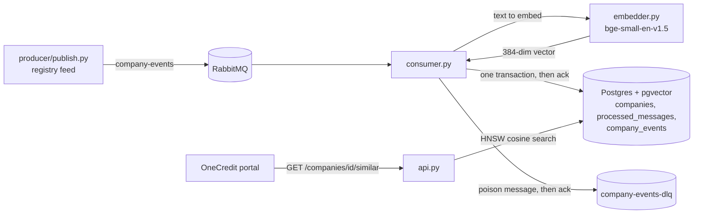
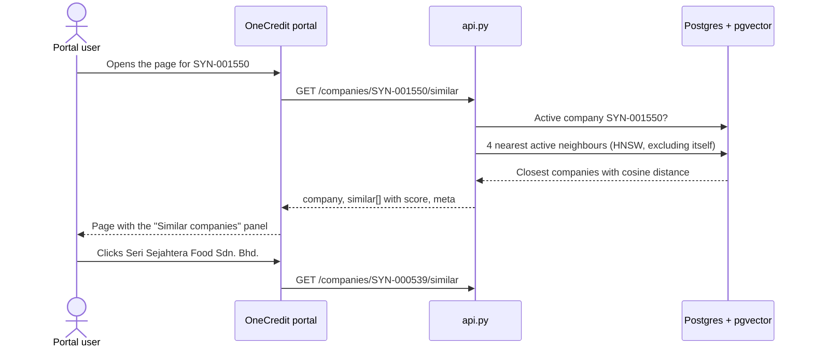

# Design

The decisions behind `company-recommendation-system`, the assumptions behind them, and what's left. Per-branch
notes, with the exact deviations from each spec, are in [`doc/`](doc/). The original brief is in
[`doc/assignment.md`](doc/assignment.md).

## Problem & scope

A company's page on the OneCredit portal should show a "Similar companies" panel: four companies that do similar
things. The registry team publishes every company change to the RabbitMQ queue `company-events`. Delivery is
at-least-once, nothing is validated, and the format is fixed. This repo turns that feed into the panel. A
consumer stores every company in Postgres with an embedding of its description. An API answers "similar to X"
with one nearest-neighbour query in pgvector.

In scope:

- a consumer that is correct under duplicates, reordering, poison messages and outages;
- an API that is fast enough to call while the page loads and fails in a way the portal can handle;
- an offline evaluation of how good the recommendations are.

Out of scope: personalisation, auth, near-duplicate company merging, and anything that needs labels the feed
doesn't have (see [What's left](#whats-left)).

## Assumptions

Where the brief was open, I made these calls:

1. **Category is a proxy for "nature of business".** It is the only label the feed has, so the evaluation counts
   a neighbour as relevant when it has the query's category. The API itself ranks by description only, not by
   category. A missing category is stored as `NULL`, never invented, and an event that leaves it out never
   clears a stored one.
2. **`updatedAt` from the source is authoritative, and ties break on `message_id`.** The consumer applies an
   event only if `(updatedAt, message_id)` is greater than what is stored, so any arrival order ends in the
   same row. The feed's `Z`, epoch-millisecond and offset-less timestamps all parse to instants. Offset-less
   ones are read as Malaysia time (+08:00).
3. **Deletes are soft, via `is_active`.** A `company-struck-off` event sets `is_active = false` and keeps the row
   and its vector for history. Struck-off companies are never recommended, and asking for one returns 404. A
   strike-off that arrives before the company's first upsert is held in `pending_strike_offs`.
4. **The panel size is 4**, as in the mock: `TOP_K = 4`, and the API's `limit` defaults to it (1 to 50).
5. **A missing description falls back to `name | category | state`**, with missing parts left out (never the text
   `"None"`). That way every company in the feed is embedded and can appear in other companies' panels ("no lost
   companies").

## Architecture

The consumer and the API share only Postgres. `consumer.py` reads `company-events` with prefetch 32. For each
message it parses the event, embeds the text with `embedder.py` (bge-small-en-v1.5 on CPU through fastembed),
and applies it in one transaction. It acks only after that transaction commits. A message that can never be
applied goes to `company-events-dlq` with an `error` header. `api.py` (FastAPI) reads the same table with an
HNSW cosine search.





## Schema & why

| Table / index | Why |
|---|---|
| `companies`, with `embedding vector(384)` and an HNSW index (`vector_cosine_ops`, m 16, ef_construction 64) | bge vectors are compared by cosine, so the index uses the cosine operator class: `ORDER BY embedding <=> q` is an index scan, not a sort over every row. HNSW needs no training step, unlike IVFFlat, so it stays accurate as companies arrive one at a time. Queries turn on `hnsw.iterative_scan = strict_order`, so the `is_active` and self-exclusion filters can't make a scan come back with fewer than `limit` rows. |
| `companies.description_hash` (SHA-256 of the embed text, indexed) | Skips re-embedding. An update whose text is unchanged keeps its vector. Text that another company already has copies that company's vector instead of running the model again. The feed has only 174 distinct descriptions for 2,000 companies, so most embeddings are copies. |
| `processed_messages (message_id PRIMARY KEY)` | Deduplication. The id is the AMQP `message_id`, else the event's own, else `sha256(body)`. It is inserted in the same transaction as the change, so "seen" and "applied" commit together or not at all. |
| `company_events` (raw `jsonb`, message id, company id) | Audit. Every applied, stale or strike-off event is kept as received, so any row can be explained and the table could be rebuilt from it. |
| `pending_strike_offs` | A strike-off for a company we haven't seen yet. It is applied when the first upsert arrives, if the strike-off is newer. |

Migrations are plain SQL files in [`migrations/`](migrations/), applied in name order. Each runs in a transaction
under an advisory lock, so it is safe to run them from every process.

## Correctness

**Idempotency and ordering are different problems.** At-least-once delivery means the same message can arrive
twice. `processed_messages` turns the second copy into a no-op. But a deduplicated feed can still arrive out of
order, and the feed has 66 updates that are older than one already received. That is solved separately, by
comparing `(updatedAt, message_id)` with the stored row under `SELECT … FOR UPDATE`. A stale event is audited
and dropped. Fields an event leaves out keep their stored values. That merge is per row, not per field: an older
event dropped as stale can't fill a gap left by a newer one. `test_chaos.py` replays the real feed in order,
reversed and shuffled with 20% redeliveries, and gets the same table every time.

**The dead-letter problem.** The registry team declares `company-events` durable with no arguments. Redeclaring
it with `x-dead-letter-exchange` fails with `PRECONDITION_FAILED`. So a nacked poison message would either loop
forever (requeue) or be dropped (no requeue, no dead-letter exchange). Instead, the consumer dead-letters
messages itself. It publishes the message to `company-events-dlq`, a durable queue it owns, with the reason in
an `error` header and the original `message_id`. Publisher confirms are on, so the publish is acknowledged
before the original is acked. Poison means unparseable JSON, no usable id or `updatedAt`, a malformed `data`,
or an unexpected error while applying it: 37 of the feed's 2,518 messages. A database outage is not poison: the
message is nacked with requeue, and the consumer reconnects with backoff.

**Ack only after commit, so acked means searchable.** The embedding is computed inside the transaction that
writes the row, the dedup record and the audit row. The ack is sent only after that transaction commits, and
the HNSW index is updated as part of the same commit. A crash before the commit means RabbitMQ redelivers the
message. A crash between the commit and the ack means a redelivery that `processed_messages` turns into a
duplicate. Either way, once a message is acked its company is already in the next `/similar` response.
Throughput pays for this: the model runs while a transaction is open, one message at a time.

## API contract

`GET /companies/{company_id}/similar?limit=4`. The id is matched the way the feed is normalised, so
`syn-001550` finds `SYN-001550`. `limit` is 1 to 50 and defaults to 4. The response has what a card needs, plus
the cosine similarity as `score`:

```json
{
  "company": {"id": "SYN-001550", "name": "Sinar Teguh Bakery Sdn. Bhd.", "category": "Food & Beverage", "state": "Selangor"},
  "similar": [
    {"id": "SYN-000539", "name": "Seri Sejahtera Food Sdn. Bhd.", "category": "Food & Beverage", "state": "Johor", "score": 1.0},
    {"id": "SYN-000263", "name": "Gemilang Delima Food Sdn. Bhd.", "category": "Food & Beverage", "state": "Johor", "score": 0.8336},
    {"id": "SYN-001650", "name": "Everbright Pacific Food Sdn. Bhd.", "category": "Food & Beverage", "state": "Kuala Lumpur", "score": 0.8336},
    {"id": "SYN-000831", "name": "Pacific Everbright Logistik PLT", "category": "Logistics", "state": "Kuala Lumpur", "score": 0.8301}
  ],
  "meta": {"model": "BAAI/bge-small-en-v1.5", "took_ms": 8.02, "count": 4}
}
```

Every error is an RFC 7807 `application/problem+json` body. Its `request_id` matches the `X-Request-ID` response
header and the request's JSON log line:

```json
{"type": "about:blank", "title": "Not Found", "status": 404,
 "detail": "No active company with registration number SYN-999999.",
 "instance": "/companies/SYN-999999/similar", "request_id": "9070f52d-e80d-465d-b8c6-4d60792c8a36"}
```

| Status | When |
|---|---|
| 200 | Found. `similar` may be empty if the company has no embedding (not possible through the consumer). |
| 404 | No such company, a struck-off company, or an unknown path. |
| 422 | `limit` outside 1 to 50, or not a number. The body adds an `errors` list. |
| 503 | Postgres is down or the pool is exhausted, with `Retry-After: 1`. |
| 500 | Anything else. The exception text is logged, never returned. |

There are also three operational endpoints:

- `/healthz` is liveness and never touches the database.
- `/readyz` runs `SELECT 1` and returns 503 if Postgres doesn't answer.
- `/metrics` serves Prometheus counters and histograms labelled by route template.

## Evaluation

`just eval` ([`src/company_recs/eval.py`](src/company_recs/eval.py)) runs three retrievers over the same table:
random, a 384-dim hashed bag of words, and bge-small through the API's own `find_similar`.

- **Queries:** the 1,855 active companies with a description longer than 10 characters and a category.
- **Candidates:** the 1,992 active companies.

From [`eval/results.md`](eval/results.md):

| Retriever | P@4 | NDCG@4 | MRR | N |
|---|---:|---:|---:|---:|
| random | 0.0880 | 0.0891 | 0.1740 | 1855 |
| hashed-bow | 0.9454 | 0.9397 | 0.9554 | 1855 |
| bge-small | 0.9523 | 0.9498 | 0.9712 | 1855 |

The same eval with each query's exact-text twins removed from its candidates:

| Retriever | P@4 | NDCG@4 | MRR | N |
|---|---:|---:|---:|---:|
| random | 0.0825 | 0.0820 | 0.1580 | 1855 |
| hashed-bow | 0.3344 | 0.3385 | 0.3695 | 1855 |
| bge-small | 0.5090 | 0.5127 | 0.5637 | 1855 |

The first table looks excellent, but mostly it measures duplicate text. 1,651 of the 1,855 queries have at
least 4 companies with exactly the same description, so any text retriever scores about 0.95 by finding them.
bge-small beats the bag of words by only 0.01 NDCG@4 there, and the `just eval` guard (exit 1 unless bge-small
wins) passes on that thin margin. The second table removes the twins: bge-small keeps about half its precision,
the bag of words a third.

That gain is almost all on English text. With twins removed, bge-small's P@4 is 0.58 on English queries but
0.34 on the 546 Malay ones, barely above the bag of words at 0.31. 94% of a Malay query's neighbours are also
Malay. bge-small-en-v1.5 is an English model, so it groups Malay descriptions by language, not by business:
a tuition centre's nearest neighbour is accounting software, and the English and Malay oil-palm descriptions
score only 0.61. (The language split uses a keyword heuristic.) A multilingual model is the first thing to try
next.

## Latency

I made 50 `curl` calls to `GET /companies/{id}/similar` for 50 different companies, against the 2,000-company
table, on a laptop with a single uvicorn process and warm caches:

| | p50 | p95 | max |
|---|---:|---:|---:|
| `meta.took_ms` (in the handler: borrow a pooled connection, look up the company, kNN query) | 6.9 ms | 9.3 ms | 12.1 ms |
| `curl` total (HTTP round trip on localhost) | 10.8 ms | 14.6 ms | 16.5 ms |

The kNN query itself runs in under 1 ms (`EXPLAIN ANALYZE` shows the HNSW index scan). Most of `took_ms` is
the two round trips to Postgres and borrowing a pooled connection. At this size, latency won't decide whether
the panel renders with the page. At 10× it still fits, because HNSW search grows roughly with log n.

## 10× volume

At 20,000 companies and about 25,000 events per replay, the database and the API barely notice. The consumer is
the bottleneck, because it embeds one message at a time inside a transaction. What I would change, in order:

- **Batch embeddings, outside the transaction.** Take up to 32 prefetched messages and embed their new texts
  (after the `description_hash` lookup) in one `embed_batch` call. Then apply each message in its own short
  transaction and ack it. The win is mainly that no transaction stays open while the model runs. Batching
  itself only pays off on a GPU or a dedicated embedding service. On this laptop's CPU, fastembed ran 128 texts/s
  at batch 1, 120 at batch 4 and 5 at its default of 256 (measured in
  [`doc/feat-embedder.md`](doc/feat-embedder.md)), so the batch size has to be measured on the target hardware.
  Deduplicating by text already removes most model calls: 174 distinct descriptions for 2,000 companies.
- **Run several consumer processes competing on `company-events`.** This is already safe by design: the
  `processed_messages` primary key and `SELECT … FOR UPDATE` on the company row serialise any two messages that
  touch the same company. It isn't tested with several processes yet.
- **Put PgBouncer (transaction pooling) in front of Postgres**, so N consumers and M API replicas don't each
  hold a pool of real connections.
- **Cache neighbour lists for hot companies in Redis**, keyed by company id and `source_message_id`, with a short
  TTL. A write to company X changes X's own list, which the key handles. It can also change other companies'
  lists that contain X, and the TTL bounds how long those stay stale.
- **Precompute the top N for popular companies overnight**, so the page load is a key lookup and the kNN query is
  the fallback.
- **Re-embed blue/green with a `model_version` column.** Write the new model's vectors to a second column with
  its own HNSW index while the API reads the old one. Switch reads once every active company has a new vector,
  then drop the old column. Today `embedder.MODEL_VERSION` exists but the column doesn't.

## Testing

`just test` runs 144 tests, `just test-chaos` the fault-injection subset, and CI runs lint, pyright and the
whole suite on every push. Integration tests share one pgvector Postgres and one RabbitMQ container per run,
pinned to the `docker-compose.yml` images. Each test starts from empty tables and purged queues.

Covered:

- **Feed quirks:** every one the feed has: timestamp formats, id normalisation, and 14 kinds of unusable
  message.
- **The consumer's transaction:** storing a company, duplicates, the message-id fallbacks, stale events and
  tie-breaks, skipping re-embedding, missing fields, strike-offs (including one that arrives early),
  dead-lettering, requeue on a database outage, and rollback.
- **The real feed:** 2,000 companies and 37 dead letters, the same table in order, reversed and shuffled with
  redeliveries, and a second replay that changes nothing.
- **End to end through RabbitMQ:** a 100-message synthetic feed with known duplicates and reordering, read back
  through the API.
- **Chaos through RabbitMQ:** the feed published twice, v2 before v1, a malformed message, no `message_id`, and
  the database failing with messages waiting.
- **The API:** the similarity SQL and HNSW index with hand-made vectors (exact scores and order, `limit = 50`
  filled), every error path, the probes and metrics.
- **The eval:** the metric arithmetic, both baselines, and the guard both passing and failing.
- **The real model** (`-m model`): shape, unit length, and that similar text is closer.

Not covered:

- several consumer processes at once;
- a RabbitMQ restart mid-stream (the reconnect loop handles broker errors, but only database failures are
  injected);
- a crash between commit and ack (it reduces to a redelivery, which is tested);
- load or concurrency on the API beyond the 50-call measurement;
- HNSW recall against exact search at larger scale;
- the eval's fixed numbers, which come from one local run, not CI.

## What's left

- **Real relevance labels.** Category match is a proxy. Clicks on a card, or "contacted" events from the portal,
  would give a ground truth worth tuning against, and an online A/B test of panel changes.
- **A multilingual embedding model** (e.g. multilingual-e5-small), measured with the same eval: about 30% of
  the descriptions are Malay, and bge-small-en groups them by language.
- **Personalisation:** ranking the panel by who is looking (their industry, past clicks), not only by the company.
- **LLM explanations** ("why is this similar?"): designed below, not built.
- **Auth and rate limiting** on the API, which assumes a trusted network today.
- **Dedup and merging of near-duplicate companies.** Many companies share a description word for word, and a few
  descriptions are one sentence repeated dozens of times, so the panel can show four companies that are the
  same business.
- **A re-embedding pipeline** for model changes (the blue/green plan above), plus a per-field merge so an older
  event can fill a field a newer one left out.

### LLM explanation design

A one-line "why" under each card, built from data we already return. Not implemented.

- **Inputs:** the query company and one neighbour (name, category, state, description) and their `score`.
  Nothing else, so the model can't draw on outside knowledge.
- **Prompt:** "In one sentence, say why company B is similar to company A. Cite only facts present in the inputs.
  If they share nothing, reply exactly `NONE`."
- **Guardrails:**
  - *Fact-grounding check:* every category, state or noun phrase in the output must appear in the inputs.
    Otherwise the output is discarded.
  - *Cache key:* `(A.id, A.source_message_id, B.id, B.source_message_id, prompt_version, model)`, so an
    explanation is generated once per pair of versions.
  - *Latency budget:* about 300 ms per panel, with all four generated in parallel.
  - *Fallback:* on timeout, `NONE` or a failed check, use the deterministic template
    `"{B} is also in {category} in {state}."` (or only the parts the two companies actually share).
- **Where it runs:** a local llama.cpp server with a small instruction-tuned model, behind
  `GET /companies/{id}/similar?explain=true`. It is off by default, because the page-load rule says the panel
  must render with the page. The portal would fetch explanations after the panel is drawn, or from the cache.

## AI tools used

- **Claude Code** (Anthropic's coding agent, Claude Opus model, in the Claude desktop app) was used throughout:
  - implementing each branch from a spec I wrote: schema, consumer, embedder, API, tests, eval;
  - running the stack and the tests;
  - measuring (batch size, latency, the eval breakdowns);
  - drafting this document and the per-branch notes in `doc/`.

  It also flagged places where a spec was unclear or wrong, and each branch note lists those deviations. Every
  change was reviewed before it was committed.
