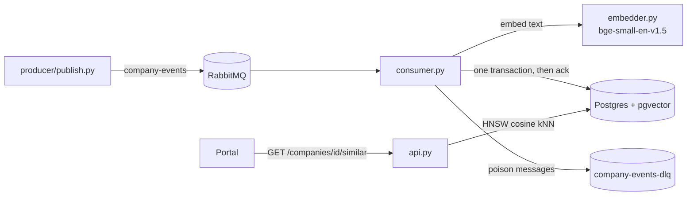

# company-recommendation-system

A "Similar companies" panel for the OneCredit portal, built from the registry's RabbitMQ feed. A consumer stores
every company in Postgres with a bge-small embedding of its description. A FastAPI service returns its nearest
neighbours with pgvector. This is a solution to the OneCredit MLE take-home; the original brief is in
[`doc/assignment.md`](doc/assignment.md).

- **Design, assumptions, 10× plan and what's left:** [`DESIGN.md`](DESIGN.md)
- **Recommendation quality:** [`eval/results.md`](eval/results.md)
- **Windows setup notes, settings and gotchas:** [`SETUP.md`](SETUP.md)

## Quickstart

You need Docker, [uv](https://docs.astral.sh/uv/) (it installs Python 3.14) and
[just](https://github.com/casey/just).

```bash
just setup      # install dependencies from uv.lock
just up         # start Postgres (with pgvector) and RabbitMQ
just publish    # put the registry feed on the company-events queue
```

In one terminal, consume the feed into Postgres. The consumer migrates the schema first, takes about 45 seconds
for the whole feed, and runs until Ctrl+C:

```bash
just consumer
```

In another terminal, serve the API on http://127.0.0.1:8000:

```bash
just api
```

Then:

```bash
curl -s http://127.0.0.1:8000/companies/SYN-001550/similar
```

```json
{"company": {"id": "SYN-001550", "name": "Sinar Teguh Bakery Sdn. Bhd.", "category": "Food & Beverage", "state": "Selangor"},
 "similar": [{"id": "SYN-000539", "name": "Seri Sejahtera Food Sdn. Bhd.", "category": "Food & Beverage", "state": "Johor", "score": 1.0}, "..."],
 "meta": {"model": "BAAI/bge-small-en-v1.5", "took_ms": 8.02, "count": 4}}
```

`?limit=` takes 1 to 50 (default 4). Errors are `application/problem+json`. Interactive docs are at
http://127.0.0.1:8000/docs.

Run the tests (Docker must be running; the integration tests start their own containers):

```bash
just test
```

Other targets:

- `just test-chaos` runs only the fault-injection tests.
- `just eval` scores the recommendations and writes `eval/results.md`.
- `just down` stops everything and deletes the data.

If ports 5432, 5672 or 15672 are taken, export `POSTGRES_PORT`, `RABBITMQ_PORT` or `RABBITMQ_UI_PORT` before
`just up`. Then set `DATABASE_URL` / `RABBITMQ_URL` to match (see [`.env.example`](.env.example)).

## Architecture



| Module | What it does |
|---|---|
| [`consumer.py`](src/company_recs/consumer.py) | Reads `company-events`. Deduplicates by message id, applies the newest `updatedAt`, embeds, writes, and acks after the commit. Dead-letters unusable messages to `company-events-dlq`. |
| [`embedder.py`](src/company_recs/embedder.py) | bge-small-en-v1.5 on CPU through fastembed. Falls back to `name \| category \| state` when there's no description. |
| [`api.py`](src/company_recs/api.py) | `GET /companies/{id}/similar`, `/healthz`, `/readyz` and `/metrics`. |
| [`eval.py`](src/company_recs/eval.py) | P@4, NDCG@4 and MRR for random, hashed bag of words and bge-small. |
| [`db.py`](src/company_recs/db.py), [`migrations/`](migrations/) | Connection pool and SQL migrations. |
